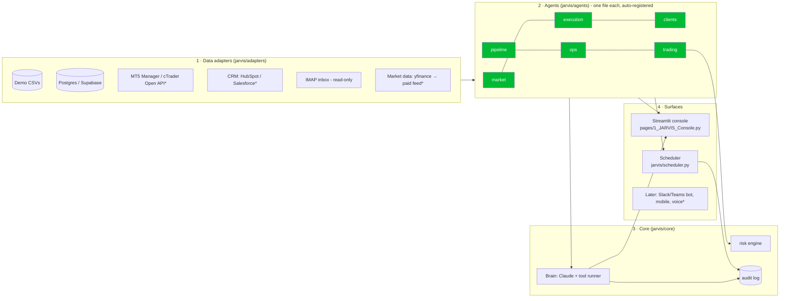

# JARVIS: an operations co-pilot for a brokerage

JARVIS runs on top of the Quant Command Center. It has four layers, and each one can be swapped out without touching the others.


`*` = planned adapters. The interface for them already exists.

## What each part covers

| Need | Agent / tool | Notes |
|---|---|---|
| How has the market been acting? | `market.regime`, `market.macro` | Trend × realised-volatility regime per symbol, a suggested playbook for each regime, and a VIX/10Y/DXY risk light |
| Bots learning, failing to execute | `execution.report` | Fill rate, adverse slippage (p50/p95), latency, and failed orders grouped by root cause with a fix for each |
| Client retention | `clients.at_risk`, `clients.book_summary` | Churn score from 0 to 100 with the reasons spelled out (inactivity, falling deposits or activity, net withdrawals, open tickets) |
| Deal pipeline / sourcing traders & IBs | `pipeline.analyse` | Weighted forecast, stage conversion, stale deals, and win rate by lead source |
| Admin / project management | `ops.tasks` | Overdue tasks and tasks due this week, per owner |
| Email | `ops.inbox`, `ops.draft_note` | Read-only scan (uses `BODY.PEEK`, so nothing is marked as read). Urgent compliance and client-money keywords are flagged. JARVIS writes drafts only and never sends |
| Personal trading | `trading.plan_trade`, `trading.trail` | Sizing by risk %, ATR hard stop, TP, max slippage and spread, daily-loss kill switch, open-risk cap. It produces plans only |
| Ask anything across all of the above | Console → *Ask JARVIS* | Claude chains the tools together and every call is audited |

## Automations you didn't ask for (in `jarvis/scheduler.py`)
- **Every 15 minutes:** an execution alert when the fill rate drops below 98% or slippage passes the limit.
- **Every 6 hours:** a retention scan that pushes the top 10 at-risk clients.
- **Daily:** stale deals with no activity for more than 14 days.
- **Weekdays at 07:00:** an AI morning brief covering market, execution, at-risk clients, stale deals and overdue tasks.

### Next ones worth adding (brokerage-specific)
- **Withdrawal-after-loss watch:** a client who withdraws right after a big loss is the top churn signal, and also a complaint risk.
- **IB/affiliate fraud patterns:** many accounts sharing an IP, device or payment card; self-referral; latency arbitrage.
- **Toxic-flow detection:** clients who are profitable at sub-second holding times (useful for A/B-book decisions).
- **KYC expiry and document renewals** before they block a withdrawal.
- **Margin-call pre-warnings** that let the account manager call the client before a stop-out.
- **Dormant high-equity accounts:** reactivation campaigns.
- **Complaint SLA tracking:** regulators (FSCA/FCA/CySEC) set response deadlines.
- **Spread and swap anomaly vs LP feed:** catches pricing configuration errors.
- **Weekly execution-quality report** for the dealing desk.

## How to grow it
1. **New capability:** add `jarvis/agents/<name>.py` with a class decorated with `@register` and methods marked `@tool()`. The Brain, the console and the scheduler pick it up automatically. Mark side-effecting tools `@tool(writes=True)` so they need human approval.
2. **Real data:** write an adapter that implements `load(table) -> DataFrame` (or richer methods), then point `default_source()` at it. The agents don't change. Set `JARVIS_DATABASE_URL` to read from Postgres.
3. **Scale the front end:** when Streamlit becomes limiting (many users, roles, real-time), put FastAPI over the same agent registry (each tool becomes an endpoint) and build a Next.js UI. The agents and the Brain stay as they are.
4. **Smarter models:** keep the churn score's feature set and swap the rule weights for a trained model once you have labelled churn history.

## Run it
```bash
pip install -r requirements.txt
export ANTHROPIC_API_KEY=...          # only needed for the chat tab and the morning brief
streamlit run dashboard.py            # log in, then open "JARVIS Console" in the sidebar
python -m jarvis.scheduler            # background automations (separate process)
pytest -q                             # risk/analytics unit tests
```
All limits are env vars (see `jarvis/core/config.py`), for example `JARVIS_RISK_PER_TRADE_PCT=0.5` and `JARVIS_MAX_DAILY_LOSS_PCT=2`.

## Guardrails (non-negotiable at a broker)
- JARVIS **never** places trades, moves money or sends email. It drafts and plans, and a human approves.
- Every prompt, tool call, error and answer goes to an append-only audit log.
- Client PII goes to the Claude API. Confirm this is covered by your data-processing agreement and privacy policy (POPIA/GDPR) before you connect real client data. Otherwise, pseudonymise the client names and IDs in the adapter.
- Personal trading by brokerage staff usually falls under a personal-account-dealing policy. Get sign-off from compliance.
- Demo data in `jarvis/data/samples` is synthetic and is generated on first run.
